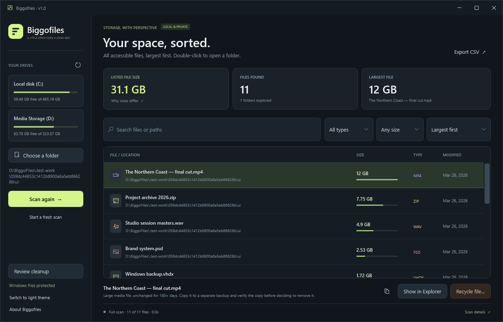
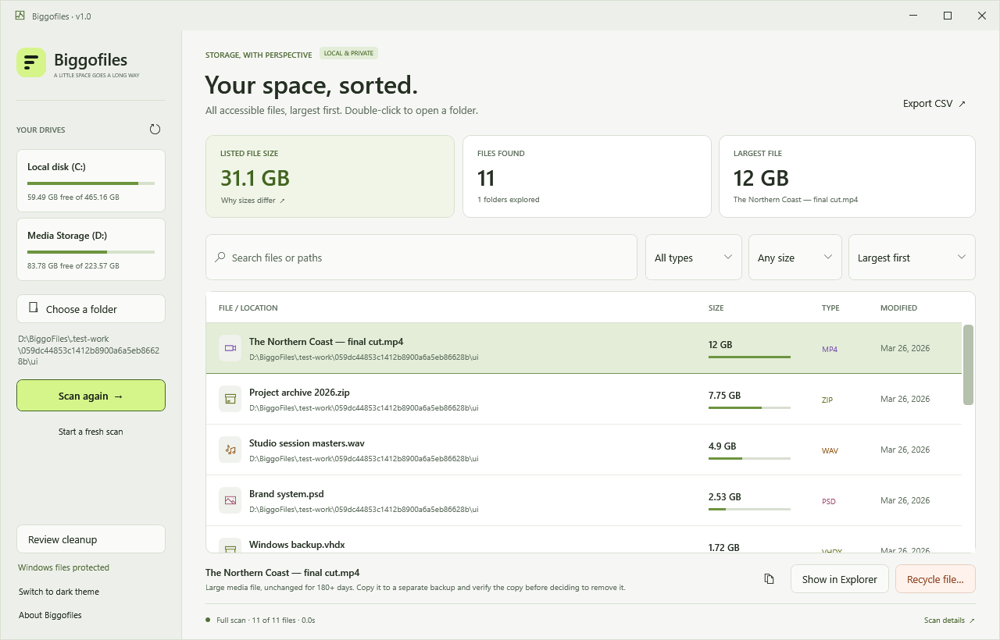

# Biggofiles

**Find the big files. Decide what stays.**

A small, native Windows storage browser by **OG STUDIO**. Pick a drive or folder and see its accessible files, ordered from largest to smallest. **v1.0 · Free · MIT licensed.**

[Website](https://ogstudioapps.com/bf/) · [Privacy policy](https://ogstudioapps.com/bf/pp.html)



*Screenshot uses generated, sparse test files to demonstrate the interface.*

## Run

1. Download and extract [Biggofiles v1.0 for Windows](downloads/Biggofiles-v1.0-win-x64.zip?raw=true). The same ZIP is in `release` after building from source.
2. Double-click `Biggofiles.exe`. Keep `Biggofiles.exe.config` beside it.
3. Select a drive or choose a folder, then select **Scan location**.
4. Search or filter the results. Select a file to reveal it in Explorer, copy its path, or move it to the Recycle Bin after confirmation.

Requires **64-bit Windows 10 or Windows 11 with .NET Framework 4.8**. No installer, web runtime, account, background service, or network connection is required. This release is unsigned; it does not yet have a publisher signing certificate.

## Features

- Native interface with dark as the default and a light-theme switch in the sidebar. Switching preserves the scan, filters, and selection.
- Recursive metadata scanning that includes hidden, system, zero-byte, extensionless, and locked files wherever Windows exposes their metadata.
- Batched directory reads with up to four workers, plus an in-memory NTFS index. **Scan again** uses Windows' change journal to refresh affected folders. The index lasts for the current app session; restarting the app begins with a full scan.
- Journal identity, checkpoint, root identity, access-context, and unsupported-record checks trigger a fresh scan when history cannot be trusted. Directory permission changes rebuild the affected trees; changes to an ancestor of the selected root require a fresh scan. **Start a fresh scan** / Shift+F5 rebuilds on demand.
- Small progress previews and incremental counters keep the interface responsive. The finished list contains **all discovered files**, with no result cap.
- Largest/smallest/name/date sorting, path and filename search, file-type and size filters.
- Background scanning, debounced background filtering, virtualized rows, and cancellation with partial results.
- Unicode and extended Windows paths; file sizes above 4 GB.
- CSV export of the current filtered/sorted results, with spreadsheet formula prefixes escaped.
- Scan coverage notes with full text export, plus an optional administrator instance.
- Confirmed Windows Recycle Bin action with a permanent-delete callback veto. Windows, boot, recovery, registry, application, and profile storage is blocked. Final checks include the resolved path, Windows Resource Protection, and shared hard links.
- **Review cleanup** suggests older large media, archives, disk images, and downloaded installers for review after a verified backup. Age means last modification, not last use. The app does not claim a file is unwanted or a backup exists.
- Double-click the actual file row to open its containing folder and select it in Explorer, including during a scan.
- OG STUDIO branding and website/privacy links are contained in the About dialog.



*Light theme uses the same generated demonstration files.*

## What the numbers mean

Biggofiles reports **logical file size**, using 1 KB = 1,024 bytes. This is not an estimate of space you will recover. Compressed or sparse files, cloud placeholders, and hard links can use less physical storage. Every hard-link path is listed separately. File data streams other than the default stream and internal NTFS metadata are not measured.

The **Listed file size** card and the drive card measure different things. For example, 465.16 GB capacity minus 59.49 GB free is 405.67 GB in use. A listed-file total of 399.23 GB is not a claim that exactly 6.44 GB of files were missed: inaccessible storage, restore points, filesystem overhead, allocation rounding, compression, sparse files, and shared hard links can affect the comparison in different directions. Select **Why sizes differ** in the app for an explanation and **Scan details** for coverage notes. Microsoft documents [allocated size separately from file length](https://learn.microsoft.com/en-us/windows/win32/api/winbase/ns-winbase-file_standard_info).

A normal Windows application cannot guarantee access to 100% of a drive. Inaccessible folders and interrupted enumerations appear in **Scan details**. Directory junctions, symbolic links, and mount points encountered beneath the chosen location are not traversed, preventing loops and crossing onto another drive. Cloud placeholder directory metadata is enumerated when exposed by its provider. Explicitly choosing a linked root scans that chosen location. An administrator instance can reach more locations, but some remain protected.

Scanning reads directory metadata, not file contents. Results describe a changing file system, not a frozen snapshot. File size, modification time, and attributes are checked again before recycling. The app never automatically deletes files, empties the Recycle Bin, or determines that a file is safe to remove. **Recycled files continue to use storage until the Recycle Bin is emptied.**

See [how scanning works](docs/SCANNING.md) for the mechanism, comparison with MFT enumeration, and accuracy boundaries. Non-NTFS locations and unavailable journals use full scans. Continuous writers whose opening change predates retained journal history can require a fresh scan to show their latest size.

## Keyboard shortcuts

| Shortcut | Action |
| --- | --- |
| Ctrl+F | Focus search |
| F5 | Scan the selected location again |
| Shift+F5 | Force a fresh scan |
| Esc | Stop an active scan |
| Double-click a result | Show it in Explorer |

## Build from source

No NuGet packages, downloads, SDK installation, or third-party libraries are used. The build uses the C# compiler included with the 64-bit .NET Framework and WPF assemblies installed in Windows.

From PowerShell in this directory:

```powershell
.\build.ps1
.\build.ps1 -Test
.\build.ps1 -Test -Package
.\build.ps1 -Test -GitHub
```

If your execution policy blocks the script, run it for this invocation with `powershell -NoProfile -ExecutionPolicy Bypass -File .\build.ps1 -Test -Package`.

The application is built into `dist`; the portable archive and SHA-256 checksum are written into `release`. The icon is generated locally by `tools/make-icon.ps1`. GitHub Actions builds and tests on Windows and uploads the portable package without publishing a release.

`-GitHub` also exports a clean `github` folder containing the source, documentation, license, workflow, screenshots, and a portable ZIP under `downloads`. It refuses to overwrite an existing export. See [publishing instructions](docs/PUBLISHING.md). The comparison scanner is compiled only into the test harness, and compiler warnings fail the build.

The tests create their own fixtures under `.test-work`, including sparse files, a directory junction, and a temporary deny-listing ACL. They remove the fixtures after restoring permissions. One small generated file is moved to the Windows Recycle Bin to exercise the real Shell integration; it may remain there until you empty it. Tests need a normal Windows user session with Recycle Bin access; a restricted sandbox may block ACL changes or Shell recycling. No personal files are modified.

See [testing notes](docs/TESTING.md) for coverage and measured results, and [contributing](CONTRIBUTING.md) for implementation details.

## License

[MIT](LICENSE) · Copyright © 2026 OG STUDIO
